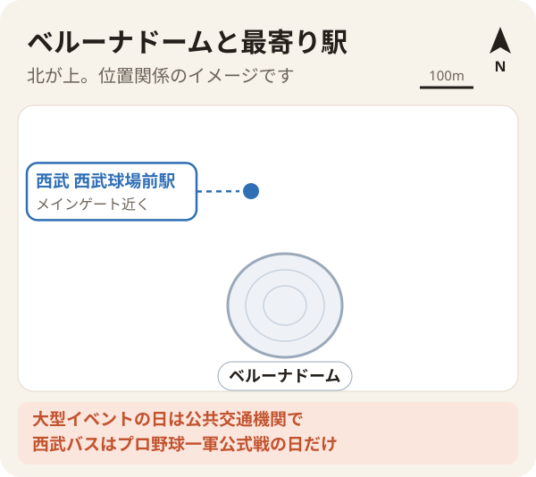
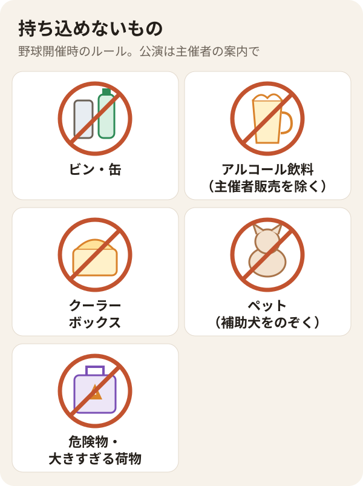

{% assign _today = site.time | date: "%Y-%m-%d" %}
この公演は終わりました。BE:FIRSTのこれからの公演は<a href="https://befirst.tokyo/tour/dometour2027/" target="_blank" rel="noopener">公式サイト</a>で確かめてください。


<section class="after-show" id="after">
<h2>🎵 公演のあと（セトリ・次の公演）</h2>

セットリストは、大手報道のライブレポートに載ったら、出典つき・ネタバレ注意の閉じた形でここに載せます。

ほかの会場の日程・セトリは：<a href="{{ p.url }}">ビーファースト 5th Anniversary DOME TOUR 2027まとめ</a>


</section>

<strong>BE:FIRST</strong>『BE:FIRST 5th Anniversary DOME TOUR 2027』の<strong>ベルーナドーム</strong>公演は、<strong>2027年3月6日（土）・7日（日）</strong>です（<a href="https://befirst.tokyo/tour/dometour2027/" target="_blank" rel="noopener">公式の公演情報</a>・2026年11月25日時点）。この記事では、ベルーナドームへの行き方・座席のつくり・持ち込めないもの・当日の準備と、会場の近くに泊まる宿の探し方、BE:FIRSTのメンバーが番組やYouTubeで訪れたお店をまとめました。

<b>公演日</b>2027年3月6日（土）・7日（日）

<nav class="live-jump" aria-label="この記事の章"><a class="chip chip--area" href="#date">日程</a><a class="chip chip--area" href="#tickets">チケット</a><a class="chip chip--area" href="#access">行き方</a><a class="chip chip--area" href="#rules">持ち込み</a><a class="chip chip--area" href="#stay">泊まる</a><a class="chip chip--area" href="#seichi">近くの聖地</a></nav>

  
🛏 ベルーナドーム周辺に泊まる<small class="stay-in__pr">PR</small><a class="stay-in__more" href="#stay">宿の選び方 ↓</a>

  

    {% include affiliate-link.html url="https://www.jalan.net/uw/uwp2011/uww2011init.do?keyword=%83x%83%8B%81%5B%83i%83h%81%5B%83%80" label="じゃらんで探す" class="btn btn--accent" service="jalan" %}
    {% include affiliate-link.html url="https://kw.travel.rakuten.co.jp/keyword/Search.do?charset=utf-8&f_query=%E3%83%99%E3%83%AB%E3%83%BC%E3%83%8A%E3%83%89%E3%83%BC%E3%83%A0" label="楽天トラベルで探す" class="btn" service="rakuten" %}
  



はじめてBE:FIRSTのライブに行くなら：<a href="/guide/befirst-first-live/">ビーファーストのライブ初参戦ガイド（ペンライトの色・コール・定番曲・入場）</a>

ほかの会場の日程・時刻・セトリは：<a href="{{ p.url }}">ビーファースト 5th Anniversary DOME TOUR 2027まとめ</a>

<h2 id="date">公演の日程</h2>

<ul class="live-dates">
  <li><b>2027年3月6日（土）</b>開場14:30／開演17:00</li>
  <li><b>2027年3月7日（日）</b>開場14:30／開演17:00</li>
</ul>

会場：<strong>ベルーナドーム</strong>（埼玉県）。公演名：BE:FIRST 5th Anniversary DOME TOUR 2027。

日程・時刻は2026年11月25日時点の<a href="https://befirst.tokyo/tour/dometour2027/" target="_blank" rel="noopener">公式発表</a>です。変わることがあるので、行く前に公式サイトで確かめてください。チケットの値段はこの記事では扱いません（受付の日程は「チケットの受付」に）。

<h2 id="tickets">チケットの受付</h2>

ベルーナドーム公演のチケットの受付です（2026年11月25日時点の公式発表）。

<ol class="tk-list">
  <li class="tk is-open" data-s="2026-11-25T18:00" data-e="2026-11-30T23:59">受付中<b class="tk__n">BESTY・B-Town会員 2次先行</b>11月25日（水）18:00〜11月30日（月）23:59BESTY・B-Town〈Architect / Resident〉の会員・全公演（抽選。当落は12月8日17:00から）<a class="tk__go" href="https://befirst.tokyo/tour/dometour2027/" target="_blank" rel="noopener">公式のお知らせ</a></li>
  <li class="tk is-soon" data-s="2026-12-03T18:00" data-e="2026-12-10T23:59">これから<b class="tk__n">アップグレード抽選（SS席）</b>12月3日（木）18:00〜12月10日（木）23:59BESTY・B-Town先行で一般指定席に当選・入金した人・SS席（特典つき・当日渡し。同行者もBESTYかB-Townの会員。即時決済のみ。当落は12月18日17:00から。SS席の一般販売はなし）<a class="tk__go" href="https://befirst.tokyo/tour/dometour2027/news/63/" target="_blank" rel="noopener">公式のお知らせ</a></li>
  <li class="tk is-tba" data-s="" data-e="">未発表<b class="tk__n">一般発売・公式リセール</b>未発表（2026年11月25日時点）<a class="tk__go" href="https://befirst.tokyo/tour/dometour2027/" target="_blank" rel="noopener">公式のお知らせ</a></li>
</ol>

終わった受付（3）

<ol class="tk-list">
  <li class="tk is-done" data-s="2026-05-22T18:00" data-e="2026-05-31T23:59">終了<b class="tk__n">BESTY会員・B-Town〈Architect〉会員先行</b>5月22日（金）18:00〜5月31日（日）23:59ファンクラブ BESTY・B-Town〈Architect〉の会員・一般指定席・着席指定席（抽選）<a class="tk__go" href="https://befirst.tokyo/tour/dometour2027/news/21/" target="_blank" rel="noopener">公式のお知らせ</a></li>
  <li class="tk is-done" data-s="2026-06-06T18:00" data-e="2026-06-11T23:59">終了<b class="tk__n">B-Town〈Resident〉会員先行</b>6月6日（土）18:00〜6月11日（木）23:59B-Town〈Resident〉の会員・抽選<a class="tk__go" href="https://befirst.tokyo/tour/dometour2027/news/25/" target="_blank" rel="noopener">公式のお知らせ</a></li>
  <li class="tk is-done" data-s="2026-06-24T15:00" data-e="2026-07-05T23:59">終了<b class="tk__n">ローソンチケット先行（Lencore・プレリクエスト）</b>6月24日（水）15:00〜7月5日（日）23:59ローソンチケット・注釈付き指定席だけ（抽選）<a class="tk__go" href="https://befirst.tokyo/tour/dometour2027/news/31/" target="_blank" rel="noopener">公式のお知らせ</a></li>
</ol>

1人1公演4枚まで。3歳以上はチケットが必要で、3歳未満は入れません。チケットはAnyPASSアプリの電子チケットです。 値段や席ごとの条件は公式のお知らせで確かめてください。チケットは公式の受付（公式のリセールがあればそれ）で買い、転売サイトでは買わないようにしましょう。

<h2 id="access">会場への行き方</h2>

<ul>
  <li><strong>西武 西武球場前駅</strong>：メインゲート近く</li>
</ul>

<figure class="fig"><figcaption>ベルーナドーム公式サイトのアクセス案内をもとに作図</figcaption></figure>

大型イベントの日は公共交通機関で

西武バスはプロ野球一軍公式戦の日だけ

<h2 id="rules">持ち込めないもの・当日の準備</h2>

<figure class="fig"><figcaption>会場の公式サイトの案内より</figcaption></figure>

会場のルールで持ち込めないもの：ビン・缶、アルコール飲料（主催者販売を除く）、クーラーボックス、ペット（補助犬をのぞく）、危険物・大きすぎる荷物。グッズの扱い・撮影・うちわやペンライトの決まりは公演ごとに違うので、BE:FIRSTの公式の注意事項で確かめてください。

<ul>
  <li><strong>ドーム内にロッカーなし</strong>：西武鉄道の駅構内の。ロッカーを使う</li>
  <li><strong>施設内にATMなし</strong>：必要なお金は。来る前に用意しておく</li>
  <li><strong>コンサート時はバスなし</strong>：西武バスはプロ野球の。一軍公式戦の日だけ</li>
  <li><strong>来場は電車がおすすめ</strong>：大型イベントの日は。駐車場に限りがある</li>
</ul>

ベルーナドーム公式サイトの案内より

<a class="btn" href="/guide/belluna-dome/">ベルーナドームのライブ参戦ガイドをくわしく</a>

<h2 id="seichi">会場の近くのBE:FIRSTの聖地</h2>

2026年11月時点で、埼玉県にBE:FIRSTのメンバーが行ったお店は登録されていません。

会場の近くにある、ほかの推しの聖地も。



<a class="btn" href="/shops/?near=35.76854,139.42047&amp;nl=%E3%83%99%E3%83%AB%E3%83%BC%E3%83%8A%E3%83%89%E3%83%BC%E3%83%A0">地図で会場の近くのお店</a><a class="btn" href="/shops/?g=befirst&amp;view=map">地図でBE:FIRSTのお店を見る</a>

<h2 id="stay">泊まる</h2>

終演後は最寄り駅が混み合います。夜の公演のあとに遠くまで移動しなくていいように、会場の近くや乗り換えの少ない駅の近くの宿を早めに探しておくと安心です。

  
🛏 ベルーナドーム周辺に泊まる<small class="stay-in__pr">PR</small>

  

    {% include affiliate-link.html url="https://www.jalan.net/uw/uwp2011/uww2011init.do?keyword=%83x%83%8B%81%5B%83i%83h%81%5B%83%80" label="じゃらんで探す" class="btn btn--accent" service="jalan" %}
    {% include affiliate-link.html url="https://kw.travel.rakuten.co.jp/keyword/Search.do?charset=utf-8&f_query=%E3%83%99%E3%83%AB%E3%83%BC%E3%83%8A%E3%83%89%E3%83%BC%E3%83%A0" label="楽天トラベルで探す" class="btn" service="rakuten" %}
  



<ul>
  <li><a href="/guide/live-ensei-checklist/">ライブ遠征の準備チェックリスト</a>：持ち物・宿・当日の動き方</li>
  <li><a href="/guide/live-ensei-transport/">ライブ遠征の交通手段ガイド</a>：新幹線・飛行機・高速バスの使い分け</li>
  <li><a href="/ensei/">ライブ遠征×聖地巡礼</a>：全国の会場の近くの聖地と宿</li>
</ul>

<h2 id="more">あわせて読みたい</h2>

<ul>
  <li><a href="/guide/belluna-dome/">ベルーナドーム ライブ参戦ガイド</a>（基本情報・ゲート・お金と荷物）</li>
  <li><a href="/guide/befirst-first-live/">ビーファーストのライブ初参戦ガイド</a>（ペンライトの色・コール・定番曲・入場・グッズ）</li>
  <li><a href="{{ p.url }}">ビーファースト 5th Anniversary DOME TOUR 2027まとめ</a>（全会場の日程・時刻・セトリ）</li>
  <li><a href="{{ site.data.group_ix.befirst.u }}">BE:FIRSTのお店一覧</a>（グループのページ）</li>
</ul>

お店の情報は、各お店の出典（番組・YouTube・ファンのロケ地ブログ）をもとにしています。会場からの距離は直線距離で、歩く距離とは違います。会場の情報はベルーナドームの公式サイトにもとづきます。

