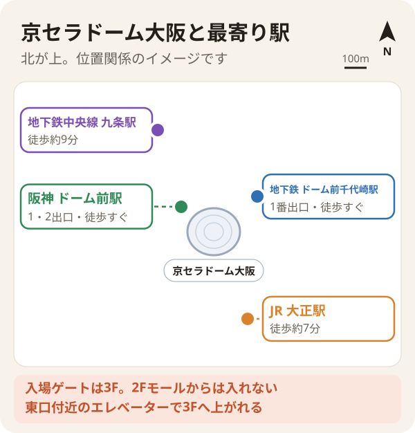
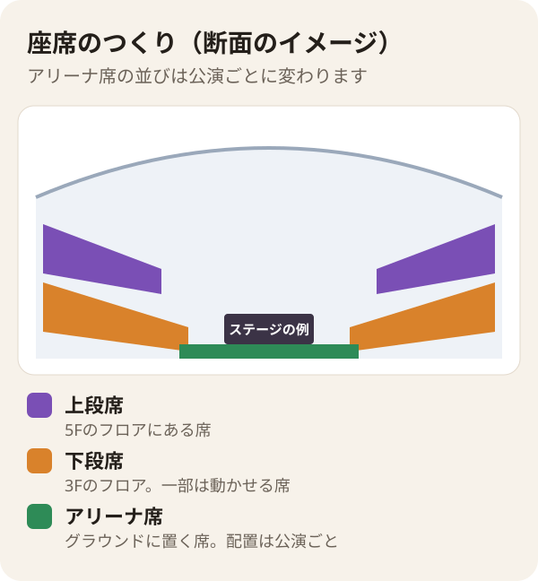
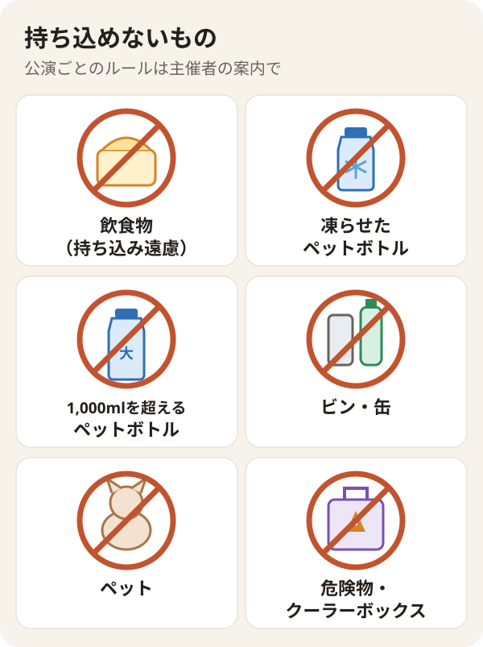

{% assign _today = site.time | date: "%Y-%m-%d" %}
この公演は終わりました。Da-iCEのこれからの公演は<a href="https://da-ice.jp/schedule/tour.php?id=1003011" target="_blank" rel="noopener">公式サイト</a>で確かめてください。


<section class="after-show" id="after">
<h2>🎵 公演のあと（セトリ・次の公演）</h2>

セットリストは、大手報道のライブレポートに載ったら、出典つき・ネタバレ注意の閉じた形でここに載せます。

ほかの会場の日程・セトリは：<a href="{{ p.url }}">ダイス 初のドーム公演2027「DAY DOME PHASE」まとめ</a>


</section>

<strong>Da-iCE</strong>『Da-iCE DAY DOME PHASE 2027』の<strong>京セラドーム大阪</strong>公演は、<strong>2027年2月13日（土）・14日（日）</strong>です（<a href="https://da-ice.jp/schedule/tour.php?id=1003011" target="_blank" rel="noopener">公式の公演情報</a>・2026年11月25日時点）。この記事では、京セラドーム大阪への行き方・座席のつくり・持ち込めないもの・当日の準備と、会場の近くに泊まる宿の探し方、Da-iCEのメンバーが番組やYouTubeで訪れたお店をまとめました。

<b>公演日</b>2027年2月13日（土）・14日（日）

<nav class="live-jump" aria-label="この記事の章"><a class="chip chip--area" href="#date">日程</a><a class="chip chip--area" href="#tickets">チケット</a><a class="chip chip--area" href="#access">行き方</a><a class="chip chip--area" href="#seats">座席</a><a class="chip chip--area" href="#rules">持ち込み</a><a class="chip chip--area" href="#stay">泊まる</a><a class="chip chip--area" href="#seichi">近くの聖地</a></nav>

  
🛏 京セラドーム大阪周辺に泊まる<small class="stay-in__pr">PR</small><a class="stay-in__more" href="#stay">宿の選び方 ↓</a>

  

    {% include affiliate-link.html url="https://www.jalan.net/uw/uwp2011/uww2011init.do?keyword=%8B%9E%83Z%83%89%83h%81%5B%83%80%91%E5%8D%E3" label="じゃらんで探す" class="btn btn--accent" service="jalan" %}
    {% include affiliate-link.html url="https://kw.travel.rakuten.co.jp/keyword/Search.do?charset=utf-8&f_query=%E4%BA%AC%E3%82%BB%E3%83%A9%E3%83%89%E3%83%BC%E3%83%A0%E5%A4%A7%E9%98%AA" label="楽天トラベルで探す" class="btn" service="rakuten" %}
  



はじめてDa-iCEのライブに行くなら：<a href="/guide/daice-first-live/">ダイスのライブ初参戦ガイド（ペンライトの色・コール・定番曲・入場）</a>

ほかの会場の日程・時刻・セトリは：<a href="{{ p.url }}">ダイス 初のドーム公演2027「DAY DOME PHASE」まとめ</a>

<h2 id="date">公演の日程</h2>

<ul class="live-dates">
  <li><b>2027年2月13日（土）</b>開場15:00／開演17:00</li>
  <li><b>2027年2月14日（日）</b>開場13:00／開演15:00</li>
</ul>

会場：<strong>京セラドーム大阪</strong>（大阪府）。公演名：Da-iCE DAY DOME PHASE 2027。

日程・時刻は2026年11月25日時点の<a href="https://da-ice.jp/schedule/tour.php?id=1003011" target="_blank" rel="noopener">公式発表</a>です。変わることがあるので、行く前に公式サイトで確かめてください。チケットの値段はこの記事では扱いません（受付の日程は「チケットの受付」に）。

<h2 id="tickets">チケットの受付</h2>

京セラドーム大阪公演のチケットの受付です（2026年11月25日時点の公式発表）。

<ol class="tk-list">
  <li class="tk is-open" data-s="2026-10-31T12:00" data-e="">発売中<b class="tk__n">プレイガイド先着受付（大阪）</b>10月31日（土）12:00〜（予定枚数に達し次第終了。終わりの時刻はプレイガイドごとに違う（イープラスは2027年1月4日23:59まで））どなたでも・mu-mo TICKET・ローソンチケット・チケットぴあ・イープラス・LINEチケット<a class="tk__go" href="https://da-ice.jp/schedule/tour.php?id=1003011" target="_blank" rel="noopener">公式のお知らせ</a></li>
</ol>

終わった受付（3）

<ol class="tk-list">
  <li class="tk is-done" data-s="2026-04-26T19:00" data-e="2026-05-19T23:59">終了<b class="tk__n">ファンクラブ a-i 最速先行（抽選）</b>4月26日（日）19:00〜5月19日（火）23:59ファンクラブ「a-i」の会員（同行者は会員でなくてよい）・一般指定席・U-18指定席・着席指定席（3days指定席は5月7日まで）。1回6枚まで<a class="tk__go" href="https://da-ice-ai.jp/contents/1068174" target="_blank" rel="noopener">公式のお知らせ</a></li>
  <li class="tk is-done" data-s="2026-05-20T15:00" data-e="2026-06-01T23:59">終了<b class="tk__n">Da-iCE CUBE先行・オフィシャル先行（抽選）</b>5月20日（水）15:00〜6月1日（月）23:59Da-iCE CUBE会員／どなたでも（オフィシャル先行）・1回6枚まで<a class="tk__go" href="https://da-ice.jp/schedule/tour.php?id=1003011" target="_blank" rel="noopener">公式のお知らせ</a></li>
  <li class="tk is-done" data-s="2026-06-26T15:00" data-e="2026-07-09T23:59">終了<b class="tk__n">プレイガイド先行（抽選）</b>6月26日（金）15:00〜7月9日（木）23:59どなたでも・このあと2次・3次先行、先着先行も<a class="tk__go" href="https://eplus.jp/daice27/" target="_blank" rel="noopener">公式のお知らせ</a></li>
</ol>

チケットはAnyPASSアプリの電子チケットです。3歳以上はチケットが必要（3歳未満は膝の上なら不要）。U-18指定席は入口で年齢の確認があるので、身分証明書を持っていきます。 値段や席ごとの条件は公式のお知らせで確かめてください。チケットは公式の受付（公式のリセールがあればそれ）で買い、転売サイトでは買わないようにしましょう。

<h2 id="access">会場への行き方</h2>

<ul>
  <li><strong>地下鉄 ドーム前千代崎駅</strong>：1番出口・徒歩すぐ</li>
  <li><strong>阪神 ドーム前駅</strong>：1・2出口・徒歩すぐ</li>
  <li><strong>JR 大正駅</strong>：徒歩約7分</li>
  <li><strong>地下鉄中央線 九条駅</strong>：徒歩約9分</li>
</ul>

<figure class="fig"><figcaption>京セラドーム大阪公式サイトのアクセス案内をもとに作図</figcaption></figure>

入場ゲートは3F。2Fモールからは入れない

東口付近のエレベーターで3Fへ上がれる

<h2 id="seats">座席のつくり</h2>

<figure class="fig"><figcaption>会場の公式情報をもとに作図。ステージの位置や客席の並びは公演ごとに変わります</figcaption></figure>

<ul>
  <li><strong>上段席</strong>：5Fのフロアにある席</li>
  <li><strong>下段席</strong>：3Fのフロア。一部は動かせる席</li>
  <li><strong>アリーナ席</strong>：グラウンドに置く席。配置は公演ごと</li>
</ul>

アリーナ席の並びは公演ごとに変わります。Da-iCEの公演の席は、チケットに書かれたゲート・席番号で確かめてください。

<h2 id="rules">持ち込めないもの・当日の準備</h2>

<figure class="fig"><figcaption>会場の公式サイトの案内より</figcaption></figure>

会場のルールで持ち込めないもの：飲食物（持ち込み遠慮）、凍らせたペットボトル、1,000mlを超えるペットボトル、ビン・缶、ペット、危険物・クーラーボックス。グッズの扱い・撮影・うちわやペンライトの決まりは公演ごとに違うので、Da-iCEの公式の注意事項で確かめてください。

<ul>
  <li><strong>店はキャッシュレス対応</strong>：カード・交通系IC・コード決済。PiTaPaは使えない</li>
  <li><strong>コインロッカーは2F</strong>：2Fスタジアムモールの。フロアマップに表示あり</li>
  <li><strong>入場ゲートは3F</strong>：2Fモールから球場内へは。直接入れない</li>
  <li><strong>場内は原則禁煙</strong>：吸うときは再入場の。手続きをして指定喫煙所へ</li>
</ul>

京セラドーム大阪公式サイトの案内より

<a class="btn" href="/guide/kyocera-dome-osaka/">京セラドーム大阪のライブ参戦ガイドをくわしく</a>

<h2 id="seichi">会場の近くのDa-iCEの聖地</h2>

2026年11月時点で、大阪府にDa-iCEのメンバーが行ったお店は登録されていません。

会場の近くにある、ほかの推しの聖地も。



<a class="btn" href="/shops/?near=34.669445,135.477173&amp;nl=%E4%BA%AC%E3%82%BB%E3%83%A9%E3%83%89%E3%83%BC%E3%83%A0%E5%A4%A7%E9%98%AA">地図で会場の近くのお店</a><a class="btn" href="/shops/?g=daice&amp;view=map">地図でDa-iCEのお店を見る</a>

<h2 id="stay">泊まる</h2>

終演後は最寄り駅が混み合います。夜の公演のあとに遠くまで移動しなくていいように、会場の近くや乗り換えの少ない駅の近くの宿を早めに探しておくと安心です。

  
🛏 京セラドーム大阪周辺に泊まる<small class="stay-in__pr">PR</small>

  

    {% include affiliate-link.html url="https://www.jalan.net/uw/uwp2011/uww2011init.do?keyword=%8B%9E%83Z%83%89%83h%81%5B%83%80%91%E5%8D%E3" label="じゃらんで探す" class="btn btn--accent" service="jalan" %}
    {% include affiliate-link.html url="https://kw.travel.rakuten.co.jp/keyword/Search.do?charset=utf-8&f_query=%E4%BA%AC%E3%82%BB%E3%83%A9%E3%83%89%E3%83%BC%E3%83%A0%E5%A4%A7%E9%98%AA" label="楽天トラベルで探す" class="btn" service="rakuten" %}
  



<ul>
  <li><a href="/guide/live-ensei-checklist/">ライブ遠征の準備チェックリスト</a>：持ち物・宿・当日の動き方</li>
  <li><a href="/guide/live-ensei-transport/">ライブ遠征の交通手段ガイド</a>：新幹線・飛行機・高速バスの使い分け</li>
  <li><a href="/ensei/">ライブ遠征×聖地巡礼</a>：全国の会場の近くの聖地と宿</li>
</ul>

<h2 id="more">あわせて読みたい</h2>

<ul>
  <li><a href="/guide/kyocera-dome-osaka/">京セラドーム大阪 ライブ参戦ガイド</a>（基本情報・ゲート・お金と荷物）</li>
  <li><a href="/guide/daice-first-live/">ダイスのライブ初参戦ガイド</a>（ペンライトの色・コール・定番曲・入場・グッズ）</li>
  <li><a href="{{ p.url }}">ダイス 初のドーム公演2027「DAY DOME PHASE」まとめ</a>（全会場の日程・時刻・セトリ）</li>
  <li><a href="{{ site.data.group_ix.daice.u }}">Da-iCEのお店一覧</a>（グループのページ）</li>
</ul>

お店の情報は、各お店の出典（番組・YouTube・ファンのロケ地ブログ）をもとにしています。会場からの距離は直線距離で、歩く距離とは違います。会場の情報は京セラドーム大阪の公式サイトにもとづきます。

