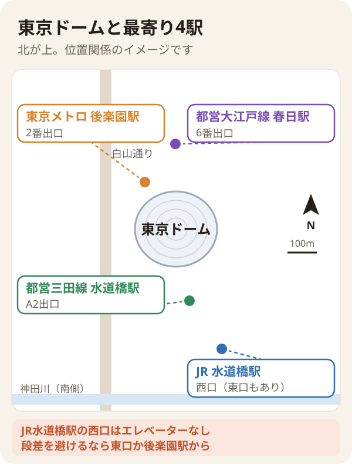
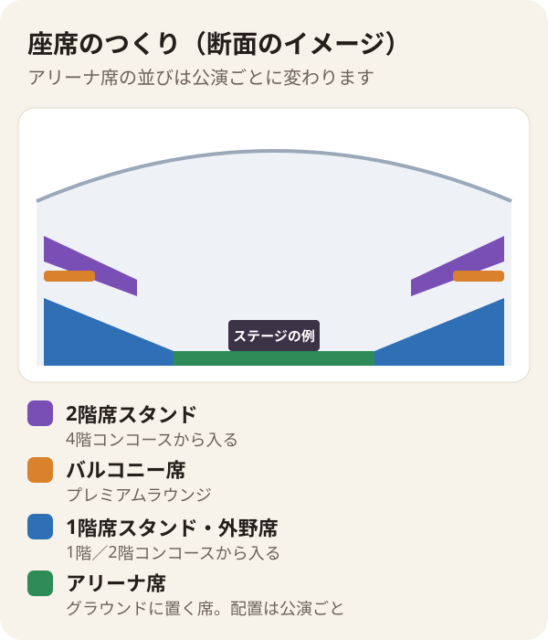
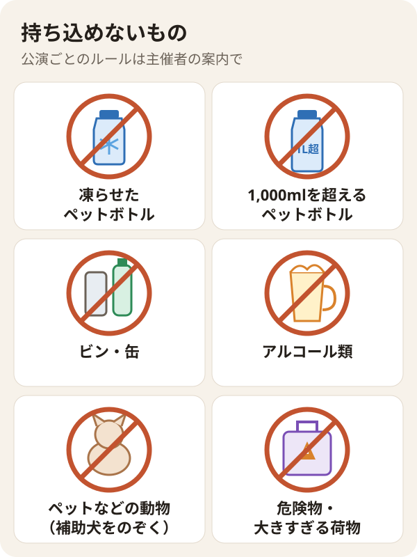

{% assign _today = site.time | date: "%Y-%m-%d" %}
この公演は終わりました。=LOVEのこれからの公演は<a href="https://equal-love.jp/schedule/detail/11617" target="_blank" rel="noopener">公式サイト</a>で確かめてください。


<section class="after-show" id="after">
<h2>🎵 公演のあと（セトリ・次の公演）</h2>

セットリストは、大手報道のライブレポートに載ったら、出典つき・ネタバレ注意の閉じた形でここに載せます。

ほかの会場の日程・セトリは：<a href="{{ p.url }}">イコラブ ドーム公演2027「全ては＝LOVE」まとめ</a>


</section>

<strong>=LOVE</strong>『＝LOVE in TOKYO DOME「全ては＝LOVE」』の<strong>東京ドーム</strong>公演は、<strong>2027年1月19日（火）・20日（水）</strong>です（<a href="https://equal-love.jp/schedule/detail/11617" target="_blank" rel="noopener">公式の公演情報</a>・2026年11月25日時点）。この記事では、東京ドームへの行き方・座席のつくり・持ち込めないもの・当日の準備と、会場の近くに泊まる宿の探し方、=LOVEのメンバーが番組やYouTubeで訪れたお店をまとめました。

<b>公演日</b>2027年1月19日（火）・20日（水）

<nav class="live-jump" aria-label="この記事の章"><a class="chip chip--area" href="#date">日程</a><a class="chip chip--area" href="#tickets">チケット</a><a class="chip chip--area" href="#access">行き方</a><a class="chip chip--area" href="#seats">座席</a><a class="chip chip--area" href="#rules">持ち込み</a><a class="chip chip--area" href="#stay">泊まる</a><a class="chip chip--area" href="#seichi">近くの聖地</a></nav>

  
🛏 東京ドーム周辺に泊まる<small class="stay-in__pr">PR</small><a class="stay-in__more" href="#stay">宿の選び方 ↓</a>

  

    {% include affiliate-link.html url="https://www.jalan.net/uw/uwp2011/uww2011init.do?keyword=%93%8C%8B%9E%83h%81%5B%83%80" label="じゃらんで探す" class="btn btn--accent" service="jalan" %}
    {% include affiliate-link.html url="https://kw.travel.rakuten.co.jp/keyword/Search.do?charset=utf-8&f_query=%E6%9D%B1%E4%BA%AC%E3%83%89%E3%83%BC%E3%83%A0" label="楽天トラベルで探す" class="btn" service="rakuten" %}
  



はじめて=LOVEのライブに行くなら：<a href="/guide/equal-love-first-live/">イコラブのライブ初参戦ガイド（ペンライトの色・コール・定番曲・入場）</a>

ほかの会場の日程・時刻・セトリは：<a href="{{ p.url }}">イコラブ ドーム公演2027「全ては＝LOVE」まとめ</a>

<h2 id="date">公演の日程</h2>

<ul class="live-dates">
  <li><b>2027年1月19日（火）</b>開場16:00／開演18:00</li>
  <li><b>2027年1月20日（水）</b>開場16:00／開演18:00</li>
</ul>

会場：<strong>東京ドーム</strong>（東京都）。公演名：＝LOVE in TOKYO DOME「全ては＝LOVE」。

日程・時刻は2026年11月25日時点の<a href="https://equal-love.jp/schedule/detail/11617" target="_blank" rel="noopener">公式発表</a>です。変わることがあるので、行く前に公式サイトで確かめてください。チケットの値段はこの記事では扱いません（受付の日程は「チケットの受付」に）。

<h2 id="tickets">チケットの受付</h2>

東京ドーム公演のチケットの受付です（2026年11月25日時点の公式発表）。

<ol class="tk-list">
  <li class="tk is-open" data-s="2026-11-21T19:30" data-e="2026-11-29T23:59">受付中<b class="tk__n">一般先行（抽選・ローソンチケット）</b>11月21日（土）19:30〜11月29日（日）23:59通常チケット（一般席・女性エリア席・カメコエリア席・着席観覧席）<a class="tk__go" href="https://equal-love.jp/news/detail/12474" target="_blank" rel="noopener">公式のお知らせ</a></li>
</ol>

終わった受付（3）

<ol class="tk-list">
  <li class="tk is-done" data-s="2026-10-13T17:00" data-e="2026-10-18T23:59">終了<b class="tk__n">FC最速先行（抽選）</b>10月13日（火）17:00〜10月18日（日）23:59応募者・同行者ともに「＝LOVE Official Fan Club」会員・プレミアムチケット・通常チケット<a class="tk__go" href="https://equal-love.jp/news/detail/12269" target="_blank" rel="noopener">公式のお知らせ</a></li>
  <li class="tk is-done" data-s="2026-10-26T18:00" data-e="2026-11-01T23:59">終了<b class="tk__n">FC先行（抽選）</b>10月26日（月）18:00〜11月1日（日）23:59「＝LOVE Official Fan Club」会員・プレミアムチケット・通常チケット<a class="tk__go" href="https://equal-love.jp/news/detail/12299" target="_blank" rel="noopener">公式のお知らせ</a></li>
  <li class="tk is-done" data-s="2026-11-09T18:00" data-e="2026-11-15T23:59">終了<b class="tk__n">三井ショッピングパーク チケット抽選販売</b>11月9日（月）18:00〜11月15日（日）23:59三井ショッピングパークポイント会員<a class="tk__go" href="https://equal-love.jp/news/detail/12399" target="_blank" rel="noopener">公式のお知らせ</a></li>
</ol>

1回の申し込みは4枚まで。チケットはすべて公式アプリ「＝LOVE Official App」の電子チケット（顔写真付き）で受け取ります。 値段や席ごとの条件は公式のお知らせで確かめてください。チケットは公式の受付（公式のリセールがあればそれ）で買い、転売サイトでは買わないようにしましょう。

<h2 id="access">会場への行き方</h2>

<ul>
  <li><strong>JR 水道橋駅</strong>：西口（東口もあり）</li>
  <li><strong>都営三田線 水道橋駅</strong>：A2出口</li>
  <li><strong>東京メトロ 後楽園駅</strong>：2番出口</li>
  <li><strong>都営大江戸線 春日駅</strong>：6番出口</li>
</ul>

<figure class="fig"><figcaption>東京ドーム公式サイトのアクセス案内をもとに作図</figcaption></figure>

JR水道橋駅の西口はエレベーターなし

段差を避けるなら東口か後楽園駅から

<h2 id="seats">座席のつくり</h2>

<figure class="fig"><figcaption>会場の公式情報をもとに作図。ステージの位置や客席の並びは公演ごとに変わります</figcaption></figure>

<ul>
  <li><strong>2階席スタンド</strong>：4階コンコースから入る</li>
  <li><strong>バルコニー席</strong>：プレミアムラウンジ</li>
  <li><strong>1階席スタンド・外野席</strong>：1階／2階コンコースから入る</li>
  <li><strong>アリーナ席</strong>：グラウンドに置く席。配置は公演ごと</li>
</ul>

アリーナ席の並びは公演ごとに変わります。=LOVEの公演の席は、チケットに書かれたゲート・席番号で確かめてください。

<h2 id="rules">持ち込めないもの・当日の準備</h2>

<figure class="fig"><figcaption>会場の公式サイトの案内より</figcaption></figure>

会場のルールで持ち込めないもの：凍らせたペットボトル、1,000mlを超えるペットボトル、ビン・缶、アルコール類、ペットなどの動物（補助犬をのぞく）、危険物・大きすぎる荷物。グッズの扱い・撮影・うちわやペンライトの決まりは公演ごとに違うので、=LOVEの公式の注意事項で確かめてください。

<ul>
  <li><strong>場内は完全キャッシュレス</strong>：現金は使えない。カード・電子マネー・。コード決済を用意</li>
  <li><strong>ロッカーは交通系ICで</strong>：Suica・PASMOなどで払う。数に限りあり</li>
  <li><strong>大きな荷物は駅かホテルへ</strong>：東京ドームシティの施設では。手荷物を預かっていない</li>
  <li><strong>脱ぎ着しやすい服で</strong>：場内の目安は。夏 約28℃・冬 約18℃</li>
</ul>

東京ドーム公式サイトの案内より

<a class="btn" href="/guide/tokyo-dome/">東京ドームのライブ参戦ガイドをくわしく</a>

<h2 id="seichi">会場の近くの=LOVEの聖地</h2>

会場から3km以内にある、=LOVEのメンバーが行ったお店を近い順に5軒。開演前や翌日に寄れる距離か、直線距離で確かめられます。

<ul class="wrs">

  <li class="wr">2026.3<b class="wr__name">ラクーア 1階フードゾーン DELI&amp;DISH</b>「【爆食】2人でたくさん食べてたくさんはしゃぎました❣️inラクーア🎡」／齋藤樹愛羅・野口衣織（文京区 春日・会場から約330m）</li>

  <li class="wr">2025.12<b class="wr__name">らーめん ぽっぽっ屋 水道橋店</b>「【二郎系ラーメン】愛してやまないみりにゃの推し麺【ぽっぽっ屋】」／大谷映美里（千代田区 神田三崎町・会場から約590m）</li>

  <li class="wr">2025.11<b class="wr__name">沼津港海将 zero 上野店</b>「【はしご酒】さなつんが上野に上陸🍻楽しく好きなだけ飲みました！！！【重大発表あり…」／諸橋沙夏（台東区 上野・会場から約2.2km）</li>

  <li class="wr">2023.11<b class="wr__name">油そば春日亭 神田店</b>「【ラー活】私の原点の場所です【春日亭】」／大谷映美里（千代田区 内神田・会場から約2.3km）</li>

  <li class="wr">2025.3<b class="wr__name">マンダリン オリエンタル東京 イタリアンダイニング ケシキ</b>「誕生日を超盛大にお祝いされてみた」／大谷映美里（中央区 日本橋室町・会場から約2.9km）</li>

</ul>

会場の近くにある、ほかの推しの聖地も。



<a class="btn" href="/shops/?near=35.705639,139.751891&amp;nl=%E6%9D%B1%E4%BA%AC%E3%83%89%E3%83%BC%E3%83%A0">地図で会場の近くのお店</a><a class="btn" href="/shops/?g=equal_love&amp;view=map">地図で=LOVEのお店を見る</a>

<h2 id="stay">泊まる</h2>

終演後は最寄り駅が混み合います。夜の公演のあとに遠くまで移動しなくていいように、会場の近くや乗り換えの少ない駅の近くの宿を早めに探しておくと安心です。

  
🛏 東京ドーム周辺に泊まる<small class="stay-in__pr">PR</small>

  

    {% include affiliate-link.html url="https://www.jalan.net/uw/uwp2011/uww2011init.do?keyword=%93%8C%8B%9E%83h%81%5B%83%80" label="じゃらんで探す" class="btn btn--accent" service="jalan" %}
    {% include affiliate-link.html url="https://kw.travel.rakuten.co.jp/keyword/Search.do?charset=utf-8&f_query=%E6%9D%B1%E4%BA%AC%E3%83%89%E3%83%BC%E3%83%A0" label="楽天トラベルで探す" class="btn" service="rakuten" %}
  



<ul>
  <li><a href="/guide/live-ensei-checklist/">ライブ遠征の準備チェックリスト</a>：持ち物・宿・当日の動き方</li>
  <li><a href="/guide/live-ensei-transport/">ライブ遠征の交通手段ガイド</a>：新幹線・飛行機・高速バスの使い分け</li>
  <li><a href="/ensei/">ライブ遠征×聖地巡礼</a>：全国の会場の近くの聖地と宿</li>
</ul>

<h2 id="more">あわせて読みたい</h2>

<ul>
  <li><a href="/guide/tokyo-dome/">東京ドーム ライブ参戦ガイド</a>（基本情報・ゲート・お金と荷物）</li>
  <li><a href="/guide/equal-love-first-live/">イコラブのライブ初参戦ガイド</a>（ペンライトの色・コール・定番曲・入場・グッズ）</li>
  <li><a href="{{ p.url }}">イコラブ ドーム公演2027「全ては＝LOVE」まとめ</a>（全会場の日程・時刻・セトリ）</li>
  <li><a href="{{ site.data.group_ix.equal_love.u }}">=LOVEのお店一覧</a>（グループのページ）</li>
</ul>

お店の情報は、各お店の出典（番組・YouTube・ファンのロケ地ブログ）をもとにしています。会場からの距離は直線距離で、歩く距離とは違います。会場の情報は東京ドームの公式サイトにもとづきます。

