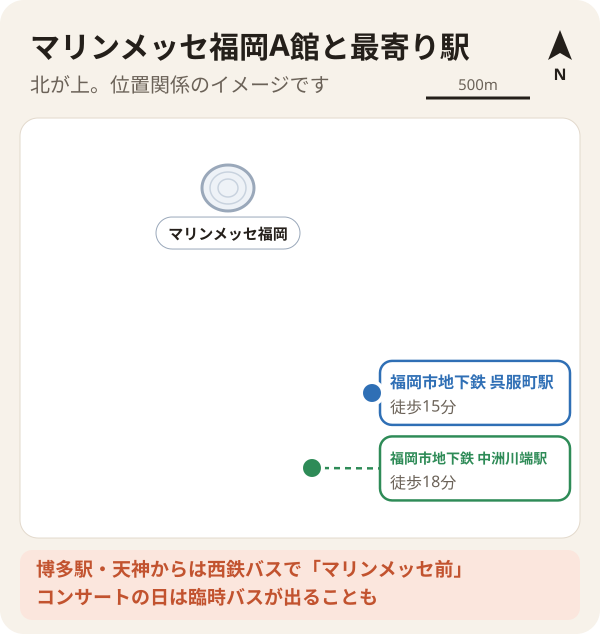
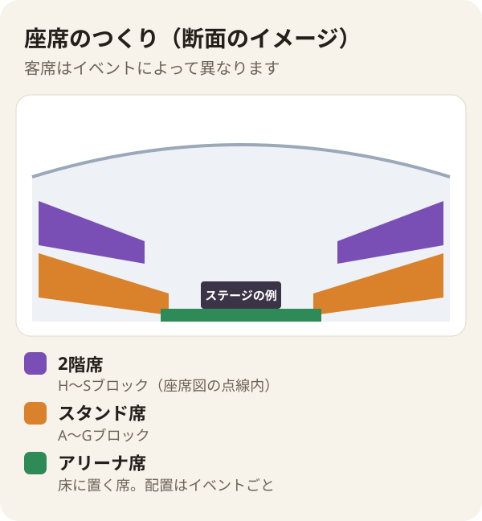

{% assign _today = site.time | date: "%Y-%m-%d" %}
この公演は終わりました。&TEAMのこれからの公演は<a href="https://www.hybejapan-concert.com/statics/andteam_mark_on_you" target="_blank" rel="noopener">公式サイト</a>で確かめてください。


<section class="after-show" id="after">
<h2>🎵 公演のあと（セトリ・次の公演）</h2>

セットリストは、大手報道のライブレポートに載ったら、出典つき・ネタバレ注意の閉じた形でここに載せます。

ほかの会場の日程・セトリは：<a href="{{ p.url }}">エンティーム ツアー'Mark on You' アリーナ公演2027（神戸・名古屋・横浜・香川・福岡・宮城）まとめ</a>


</section>

<strong>&TEAM</strong>『2026-2027 &amp;TEAM CONCERT TOUR 'Mark on You'』の<strong>マリンメッセ福岡 B館</strong>公演は、<strong>2027年3月20日（土）・21日（日）・22日（月）</strong>です（<a href="https://www.hybejapan-concert.com/statics/andteam_mark_on_you" target="_blank" rel="noopener">公式の公演情報</a>・2026年11月25日時点）。この記事では、マリンメッセ福岡 B館への行き方・座席のつくり・持ち込めないもの・当日の準備と、会場の近くに泊まる宿の探し方、&TEAMのメンバーが番組やYouTubeで訪れたお店をまとめました。

<b>公演日</b>2027年3月20日（土）・21日（日）・22日（月）

<nav class="live-jump" aria-label="この記事の章"><a class="chip chip--area" href="#date">日程</a><a class="chip chip--area" href="#tickets">チケット</a><a class="chip chip--area" href="#access">行き方</a><a class="chip chip--area" href="#seats">座席</a><a class="chip chip--area" href="#rules">持ち込み</a><a class="chip chip--area" href="#stay">泊まる</a><a class="chip chip--area" href="#seichi">近くの聖地</a></nav>

  
🛏 マリンメッセ福岡 B館周辺に泊まる<small class="stay-in__pr">PR</small><a class="stay-in__more" href="#stay">宿の選び方 ↓</a>

  

    {% include affiliate-link.html url="https://www.jalan.net/uw/uwp2011/uww2011init.do?keyword=%83%7D%83%8A%83%93%83%81%83b%83Z%95%9F%89%AAA%8A%D9" label="じゃらんで探す" class="btn btn--accent" service="jalan" %}
    {% include affiliate-link.html url="https://kw.travel.rakuten.co.jp/keyword/Search.do?charset=utf-8&f_query=%E3%83%9E%E3%83%AA%E3%83%B3%E3%83%A1%E3%83%83%E3%82%BB%E7%A6%8F%E5%B2%A1A%E9%A4%A8" label="楽天トラベルで探す" class="btn" service="rakuten" %}
  



はじめて&TEAMのライブに行くなら：<a href="/guide/kpop-andteam-first-live/">エンティームのライブ初参戦ガイド（ペンライトの色・コール・定番曲・入場）</a>

ほかの会場の日程・時刻・セトリは：<a href="{{ p.url }}">エンティーム ツアー'Mark on You' アリーナ公演2027（神戸・名古屋・横浜・香川・福岡・宮城）まとめ</a>

<h2 id="date">公演の日程</h2>

<ul class="live-dates">
  <li><b>2027年3月20日（土）</b>開場16:00／開演17:00</li>
  <li><b>2027年3月21日（日）</b>開場15:00／開演16:00</li>
  <li><b>2027年3月22日（月）</b>開場15:00／開演16:00</li>
</ul>

会場：<strong>マリンメッセ福岡 B館</strong>（福岡県）。公演名：2026-2027 &amp;TEAM CONCERT TOUR 'Mark on You'。

会場はマリンメッセ福岡のB館で、A館とは別の建物です。この記事の行き方・座席・持ち込みはA館の会場ガイドのもので、宿や近くの店の距離もA館から測っています。入口などは公式の案内で確かめてください。

日程・時刻は2026年11月25日時点の<a href="https://www.hybejapan-concert.com/statics/andteam_mark_on_you" target="_blank" rel="noopener">公式発表</a>です。変わることがあるので、行く前に公式サイトで確かめてください。チケットの値段はこの記事では扱いません（受付の日程は「チケットの受付」に）。

<h2 id="tickets">チケットの受付</h2>

マリンメッセ福岡 B館公演のチケットの受付です（2026年11月25日時点の公式発表）。

<ol class="tk-list">
  <li class="tk is-tba" data-s="" data-e="">未発表<b class="tk__n">プレミアムシート アップグレード抽選</b>「詳細は後日」（2026年11月25日時点）<a class="tk__go" href="https://www.andteam-official.jp/news/a19339147e37" target="_blank" rel="noopener">公式のお知らせ</a></li>
  <li class="tk is-tba" data-s="" data-e="">未発表<b class="tk__n">一般発売（アリーナ公演）</b>未発表（2026年11月25日時点）<a class="tk__go" href="https://www.hybejapan-concert.com/statics/andteam_mark_on_you" target="_blank" rel="noopener">公式のお知らせ</a></li>
</ol>

終わった受付（1）

<ol class="tk-list">
  <li class="tk is-done" data-s="2026-11-07T13:00" data-e="2026-11-15T23:59">終了<b class="tk__n">LUNÉ MEMBERSHIP 会員先行（抽選・アリーナ公演）</b>11月7日（土）13:00〜11月15日（日）23:59ファンクラブ LUNÉ MEMBERSHIP（日本）の会員（同行者は会員でなくてよい）・指定席。当落と入金は11月24日11:00〜11月29日23:00（ローソン・ミニストップで支払い）<a class="tk__go" href="https://www.andteam-official.jp/news/a19339147e37" target="_blank" rel="noopener">公式のお知らせ</a></li>
</ol>

チケットはローソン・ミニストップで発券する紙のチケットです。3歳以上はチケットが必要で、3歳未満は入れません。プレミアムシートの一般販売はありません。 値段や席ごとの条件は公式のお知らせで確かめてください。チケットは公式の受付（公式のリセールがあればそれ）で買い、転売サイトでは買わないようにしましょう。

<h2 id="access">会場への行き方</h2>

<ul>
  <li><strong>福岡市地下鉄 呉服町駅</strong>：徒歩15分</li>
  <li><strong>福岡市地下鉄 中洲川端駅</strong>：徒歩18分</li>
</ul>

<figure class="fig"><figcaption>マリンメッセ福岡 B館公式サイトのアクセス案内をもとに作図</figcaption></figure>

博多駅・天神からは西鉄バスで「マリンメッセ前」

コンサートの日は臨時バスが出ることも

<h2 id="seats">座席のつくり</h2>

<figure class="fig"><figcaption>会場の公式情報をもとに作図。ステージの位置や客席の並びは公演ごとに変わります</figcaption></figure>

<ul>
  <li><strong>2階席</strong>：H〜Sブロック（座席図の点線内）</li>
  <li><strong>スタンド席</strong>：A〜Gブロック</li>
  <li><strong>アリーナ席</strong>：床に置く席。配置はイベントごと</li>
</ul>

客席はイベントによって異なります。&TEAMの公演の席は、チケットに書かれたゲート・席番号で確かめてください。

<h2 id="rules">持ち込めないもの・当日の準備</h2>

<ul>
  <li><strong>博多駅・天神からバス</strong>：博多駅から約15分。天神から約12分</li>
  <li><strong>臨時バスも確認</strong>：コンサートの日だけ運行。西鉄の臨時バス情報で</li>
  <li><strong>ロッカーは1階ロビー</strong>：1階エントランスロビーの。両わきにある</li>
  <li><strong>場内の飲食は公演ごと</strong>：可否は主催者の案内で。2階にレストランあり</li>
</ul>

マリンメッセ福岡A館 公式サイトの案内より

<a class="btn" href="/guide/marine-messe-fukuoka/">マリンメッセ福岡 B館のライブ参戦ガイドをくわしく</a>

<h2 id="seichi">会場の近くの&TEAMの聖地</h2>

会場から10km以内にある、&TEAMのメンバーが行ったお店を近い順に1軒。開演前や翌日に寄れる距離か、直線距離で確かめられます。

<ul class="wrs">

  <li class="wr">2024.2<b class="wr__name">有吉商店 渡辺通り店</b>「[&amp;DAY] VLOG in Fukuoka | 휴가 중 먹는 라멘🍜 - &amp;…」／NICHOLAS・TAKI・MAKI（福岡市 中央区渡辺通・会場から約2.5km）</li>

</ul>

会場の近くにある、ほかの推しの聖地も。



<a class="btn" href="/shops/?near=33.607279,130.402104&amp;nl=%E3%83%9E%E3%83%AA%E3%83%B3%E3%83%A1%E3%83%83%E3%82%BB%E7%A6%8F%E5%B2%A1%20B%E9%A4%A8">地図で会場の近くのお店</a><a class="btn" href="/shops/?g=kpop_andteam&amp;view=map">地図で&TEAMのお店を見る</a>

<h2 id="stay">泊まる</h2>

終演後は最寄り駅が混み合います。夜の公演のあとに遠くまで移動しなくていいように、会場の近くや乗り換えの少ない駅の近くの宿を早めに探しておくと安心です。

  
🛏 マリンメッセ福岡 B館周辺に泊まる<small class="stay-in__pr">PR</small>

  

    {% include affiliate-link.html url="https://www.jalan.net/uw/uwp2011/uww2011init.do?keyword=%83%7D%83%8A%83%93%83%81%83b%83Z%95%9F%89%AAA%8A%D9" label="じゃらんで探す" class="btn btn--accent" service="jalan" %}
    {% include affiliate-link.html url="https://kw.travel.rakuten.co.jp/keyword/Search.do?charset=utf-8&f_query=%E3%83%9E%E3%83%AA%E3%83%B3%E3%83%A1%E3%83%83%E3%82%BB%E7%A6%8F%E5%B2%A1A%E9%A4%A8" label="楽天トラベルで探す" class="btn" service="rakuten" %}
  



<ul>
  <li><a href="/guide/live-ensei-checklist/">ライブ遠征の準備チェックリスト</a>：持ち物・宿・当日の動き方</li>
  <li><a href="/guide/live-ensei-transport/">ライブ遠征の交通手段ガイド</a>：新幹線・飛行機・高速バスの使い分け</li>
  <li><a href="/ensei/">ライブ遠征×聖地巡礼</a>：全国の会場の近くの聖地と宿</li>
</ul>

<h2 id="more">あわせて読みたい</h2>

<ul>
  <li><a href="/guide/marine-messe-fukuoka/">マリンメッセ福岡 B館 ライブ参戦ガイド</a>（基本情報・ゲート・お金と荷物）</li>
  <li><a href="/guide/kpop-andteam-first-live/">エンティームのライブ初参戦ガイド</a>（ペンライトの色・コール・定番曲・入場・グッズ）</li>
  <li><a href="{{ p.url }}">エンティーム ツアー'Mark on You' アリーナ公演2027（神戸・名古屋・横浜・香川・福岡・宮城）まとめ</a>（全会場の日程・時刻・セトリ）</li>
  <li><a href="{{ site.data.group_ix.kpop_andteam.u }}">&TEAMのお店一覧</a>（グループのページ）</li>
</ul>

お店の情報は、各お店の出典（番組・YouTube・ファンのロケ地ブログ）をもとにしています。会場からの距離は直線距離で、歩く距離とは違います。会場の情報はマリンメッセ福岡 B館の公式サイトにもとづきます。

