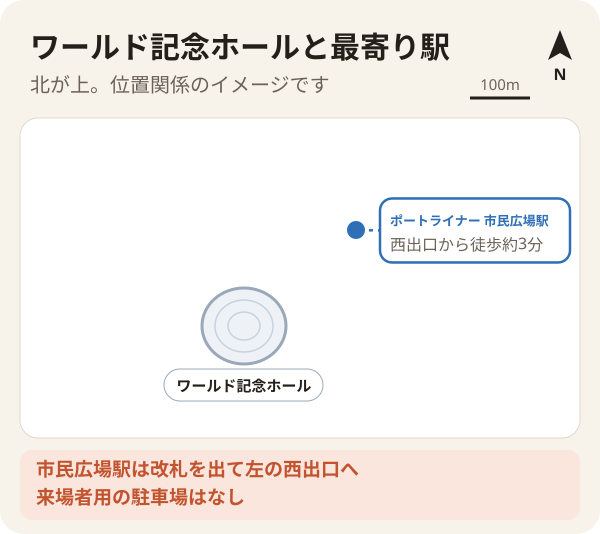
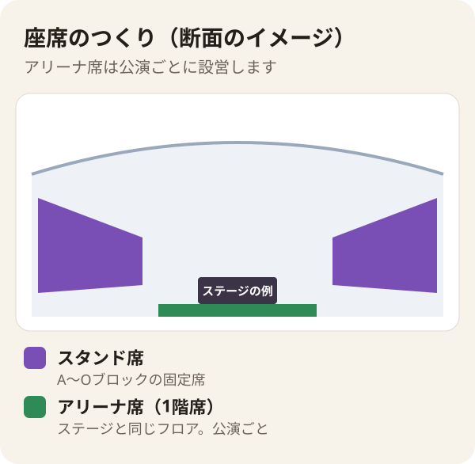

{% assign _today = site.time | date: "%Y-%m-%d" %}
この公演は終わりました。ももいろクローバーZのこれからの公演は<a href="https://www.momoclo.net/archives/news/261017_01" target="_blank" rel="noopener">公式サイト</a>で確かめてください。


<section class="after-show" id="after">
<h2>🎵 公演のあと（セトリ・次の公演）</h2>

セットリストは、大手報道のライブレポートに載ったら、出典つき・ネタバレ注意の閉じた形でここに載せます。

ほかの会場の日程・セトリは：<a href="{{ p.url }}">ももクロ アリーナツアー2027「VOGUE AND ROMANCE」まとめ</a>


</section>

<strong>ももいろクローバーZ</strong>『MOMOIRO CLOVER Z ARENA TOUR 2027 “VOGUE AND ROMANCE”』の<strong>ワールド記念ホール</strong>公演は、<strong>2027年4月24日（土）・25日（日）</strong>です（<a href="https://www.momoclo.net/archives/news/261017_01" target="_blank" rel="noopener">公式の公演情報</a>・2026年11月25日時点）。この記事では、ワールド記念ホールへの行き方・座席のつくり・持ち込めないもの・当日の準備と、会場の近くに泊まる宿の探し方、ももいろクローバーZのメンバーが番組やYouTubeで訪れたお店をまとめました。

<b>公演日</b>2027年4月24日（土）・25日（日）

<nav class="live-jump" aria-label="この記事の章"><a class="chip chip--area" href="#date">日程</a><a class="chip chip--area" href="#tickets">チケット</a><a class="chip chip--area" href="#access">行き方</a><a class="chip chip--area" href="#seats">座席</a><a class="chip chip--area" href="#rules">持ち込み</a><a class="chip chip--area" href="#stay">泊まる</a><a class="chip chip--area" href="#seichi">近くの聖地</a></nav>

  
🛏 ワールド記念ホール周辺に泊まる<small class="stay-in__pr">PR</small><a class="stay-in__more" href="#stay">宿の選び方 ↓</a>

  

    {% include affiliate-link.html url="https://www.jalan.net/uw/uwp2011/uww2011init.do?keyword=%83%8F%81%5B%83%8B%83h%8BL%94O%83z%81%5B%83%8B" label="じゃらんで探す" class="btn btn--accent" service="jalan" %}
    {% include affiliate-link.html url="https://kw.travel.rakuten.co.jp/keyword/Search.do?charset=utf-8&f_query=%E3%83%AF%E3%83%BC%E3%83%AB%E3%83%89%E8%A8%98%E5%BF%B5%E3%83%9B%E3%83%BC%E3%83%AB" label="楽天トラベルで探す" class="btn" service="rakuten" %}
  



はじめてももいろクローバーZのライブに行くなら：<a href="/guide/momoclo-first-live/">ももクロのライブ初参戦ガイド（ペンライトの色・コール・定番曲・入場）</a>

ほかの会場の日程・時刻・セトリは：<a href="{{ p.url }}">ももクロ アリーナツアー2027「VOGUE AND ROMANCE」まとめ</a>

<h2 id="date">公演の日程</h2>

<ul class="live-dates">
  <li><b>2027年4月24日（土）</b>開場16:30／開演17:30</li>
  <li><b>2027年4月25日（日）</b>開場15:30／開演16:30</li>
</ul>

会場：<strong>ワールド記念ホール</strong>（兵庫県）。公演名：MOMOIRO CLOVER Z ARENA TOUR 2027 “VOGUE AND ROMANCE”。

1日目は「Chronostasis」、2日目は「Singularity」と内容が違います。終演予定は1日目が20:00、2日目が19:00です（公式の特設サイト）。

日程・時刻は2026年11月25日時点の<a href="https://www.momoclo.net/archives/news/261017_01" target="_blank" rel="noopener">公式発表</a>です。変わることがあるので、行く前に公式サイトで確かめてください。チケットの値段はこの記事では扱いません（受付の日程は「チケットの受付」に）。

<h2 id="tickets">チケットの受付</h2>

ワールド記念ホール公演のチケットの受付です（2026年11月25日時点の公式発表）。

<ol class="tk-list">
  <li class="tk is-tba" data-s="" data-e="">未発表<b class="tk__n">一般発売</b>未発表（2026年11月25日時点）<a class="tk__go" href="https://www.momoclo.net/arenatour2027/" target="_blank" rel="noopener">公式のお知らせ</a></li>
</ol>

終わった受付（2）

<ol class="tk-list">
  <li class="tk is-done" data-s="2026-10-17T18:00" data-e="2026-10-25T23:59">終了<b class="tk__n">ANGEL EYES会員先行（抽選）</b>10月17日（土）18:00〜10月25日（日）23:59ファンクラブ ANGEL EYES の会員（同行者は会員でなくてよい）・指定席・着席指定席・お子様ファミリー席。顔写真の登録が必要<a class="tk__go" href="https://www.momoclo.net/archives/news/261017_01" target="_blank" rel="noopener">公式のお知らせ</a></li>
  <li class="tk is-done" data-s="2026-11-20T18:00" data-e="2026-11-25T23:59">終了<b class="tk__n">プレオーダー（抽選・イープラス）</b>11月20日（金）18:00〜11月25日（水）23:59どなたでも・指定席・着席指定席（お子様ファミリー席は別の受付）。当落は11月28日13:00から<a class="tk__go" href="https://www.momoclo.net/archives/news/261120_01" target="_blank" rel="noopener">公式のお知らせ</a></li>
</ol>

指定席・着席指定席は1回4枚まで。3歳未満は大人1人につき1人まで膝の上で見られます（席が要る場合はチケットが必要）。ファンクラブのチケットはANGEL EYESのIC会員証で顔認証入場、プレイガイドのチケットは紙のチケットと顔写真付きの身分証明書で入場します。 値段や席ごとの条件は公式のお知らせで確かめてください。チケットは公式の受付（公式のリセールがあればそれ）で買い、転売サイトでは買わないようにしましょう。

<h2 id="access">会場への行き方</h2>

<ul>
  <li><strong>ポートライナー 市民広場駅</strong>：西出口から徒歩約3分</li>
</ul>

<figure class="fig"><figcaption>ワールド記念ホール公式サイトのアクセス案内をもとに作図</figcaption></figure>

市民広場駅は改札を出て左の西出口へ

来場者用の駐車場はなし

<h2 id="seats">座席のつくり</h2>

<figure class="fig"><figcaption>会場の公式情報をもとに作図。ステージの位置や客席の並びは公演ごとに変わります</figcaption></figure>

<ul>
  <li><strong>スタンド席</strong>：A〜Oブロックの固定席</li>
  <li><strong>アリーナ席（1階席）</strong>：ステージと同じフロア。公演ごと</li>
</ul>

アリーナ席は公演ごとに設営します。ももいろクローバーZの公演の席は、チケットに書かれたゲート・席番号で確かめてください。

<h2 id="rules">持ち込めないもの・当日の準備</h2>

<ul>
  <li><strong>コインロッカーはない</strong>：ホールにはロッカーがない。荷物は三宮などで預ける</li>
  <li><strong>ポートライナーで</strong>：三宮から市民広場駅まで。約10分。駐車場はない</li>
  <li><strong>館内は禁煙</strong>：喫煙所はイベントごとに。屋外に設置</li>
  <li><strong>落とし物は翌日13時以降</strong>：ホールに電話で問い合わせ。078-302-8781</li>
</ul>

ワールド記念ホール公式サイトの案内より

<a class="btn" href="/guide/kobe-world-kinen-hall/">ワールド記念ホールのライブ参戦ガイドをくわしく</a>

<h2 id="seichi">会場の近くのももいろクローバーZの聖地</h2>

2026年11月時点で、兵庫県にももいろクローバーZのメンバーが行ったお店は登録されていません。

会場の近くにある、ほかの推しの聖地も。



<a class="btn" href="/shops/?near=34.663981,135.210142&amp;nl=%E3%83%AF%E3%83%BC%E3%83%AB%E3%83%89%E8%A8%98%E5%BF%B5%E3%83%9B%E3%83%BC%E3%83%AB">地図で会場の近くのお店</a><a class="btn" href="/shops/?g=momoclo&amp;view=map">地図でももいろクローバーZのお店を見る</a>

<h2 id="stay">泊まる</h2>

終演後は最寄り駅が混み合います。夜の公演のあとに遠くまで移動しなくていいように、会場の近くや乗り換えの少ない駅の近くの宿を早めに探しておくと安心です。

  
🛏 ワールド記念ホール周辺に泊まる<small class="stay-in__pr">PR</small>

  

    {% include affiliate-link.html url="https://www.jalan.net/uw/uwp2011/uww2011init.do?keyword=%83%8F%81%5B%83%8B%83h%8BL%94O%83z%81%5B%83%8B" label="じゃらんで探す" class="btn btn--accent" service="jalan" %}
    {% include affiliate-link.html url="https://kw.travel.rakuten.co.jp/keyword/Search.do?charset=utf-8&f_query=%E3%83%AF%E3%83%BC%E3%83%AB%E3%83%89%E8%A8%98%E5%BF%B5%E3%83%9B%E3%83%BC%E3%83%AB" label="楽天トラベルで探す" class="btn" service="rakuten" %}
  



<ul>
  <li><a href="/guide/live-ensei-checklist/">ライブ遠征の準備チェックリスト</a>：持ち物・宿・当日の動き方</li>
  <li><a href="/guide/live-ensei-transport/">ライブ遠征の交通手段ガイド</a>：新幹線・飛行機・高速バスの使い分け</li>
  <li><a href="/ensei/">ライブ遠征×聖地巡礼</a>：全国の会場の近くの聖地と宿</li>
</ul>

<h2 id="more">あわせて読みたい</h2>

<ul>
  <li><a href="/guide/kobe-world-kinen-hall/">ワールド記念ホール ライブ参戦ガイド</a>（基本情報・ゲート・お金と荷物）</li>
  <li><a href="/guide/momoclo-first-live/">ももクロのライブ初参戦ガイド</a>（ペンライトの色・コール・定番曲・入場・グッズ）</li>
  <li><a href="{{ p.url }}">ももクロ アリーナツアー2027「VOGUE AND ROMANCE」まとめ</a>（全会場の日程・時刻・セトリ）</li>
  <li><a href="{{ site.data.group_ix.momoclo.u }}">ももいろクローバーZのお店一覧</a>（グループのページ）</li>
</ul>

お店の情報は、各お店の出典（番組・YouTube・ファンのロケ地ブログ）をもとにしています。会場からの距離は直線距離で、歩く距離とは違います。会場の情報はワールド記念ホールの公式サイトにもとづきます。

