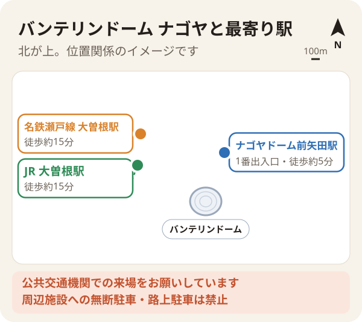
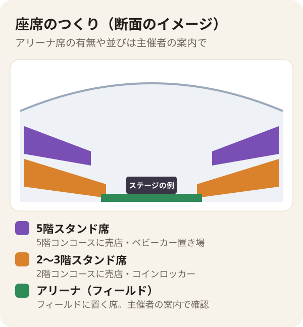
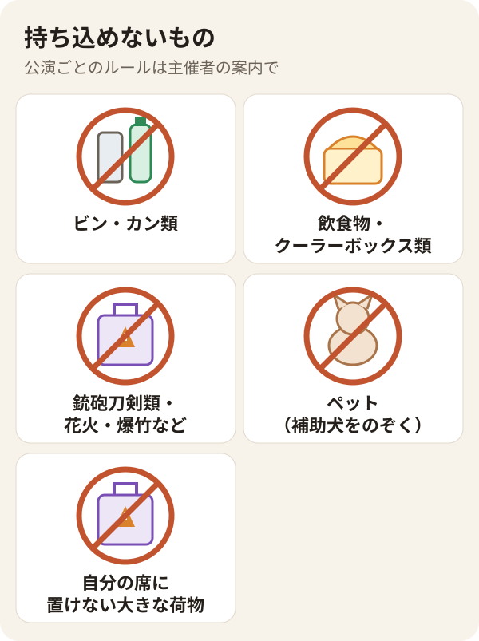

{% assign _today = site.time | date: "%Y-%m-%d" %}
この公演は終わりました。Number_iのこれからの公演は<a href="https://tobe-official.jp/artists/number_i/concert/364" target="_blank" rel="noopener">公式サイト</a>で確かめてください。


<strong>Number_i</strong>『Number_i LIVE TOUR No.Ⅲ』の<strong>バンテリンドーム ナゴヤ</strong>公演は、<strong>2027年1月9日（土）・10日（日）・11日（月）</strong>です（<a href="https://tobe-official.jp/artists/number_i/concert/364" target="_blank" rel="noopener">公式の公演情報</a>・2026年11月23日時点）。この記事では、バンテリンドーム ナゴヤへの行き方・座席のつくり・持ち込めないもの・当日の準備と、会場の近くに泊まる宿の探し方、Number_iのメンバーが番組やYouTubeで訪れたお店をまとめました。

<b>公演日</b>2027年1月9日（土）・10日（日）・11日（月）

<nav class="live-jump" aria-label="この記事の章"><a class="chip chip--area" href="#date">日程</a><a class="chip chip--area" href="#tickets">チケット</a><a class="chip chip--area" href="#access">行き方</a><a class="chip chip--area" href="#seats">座席</a><a class="chip chip--area" href="#rules">持ち込み</a><a class="chip chip--area" href="#stay">泊まる</a><a class="chip chip--area" href="#seichi">近くの聖地</a></nav>

  
🛏 バンテリンドーム ナゴヤ周辺に泊まる<small class="stay-in__pr">PR</small><a class="stay-in__more" href="#stay">宿の選び方 ↓</a>

  

    {% include affiliate-link.html url="https://www.jalan.net/uw/uwp2011/uww2011init.do?keyword=%83o%83%93%83e%83%8A%83%93%83h%81%5B%83%80%20%83i%83S%83%84" label="じゃらんで探す" class="btn btn--accent" service="jalan" %}
    {% include affiliate-link.html url="https://kw.travel.rakuten.co.jp/keyword/Search.do?charset=utf-8&f_query=%E3%83%90%E3%83%B3%E3%83%86%E3%83%AA%E3%83%B3%E3%83%89%E3%83%BC%E3%83%A0%20%E3%83%8A%E3%82%B4%E3%83%A4" label="楽天トラベルで探す" class="btn" service="rakuten" %}
  



はじめてNumber_iのライブに行くなら：<a href="/guide/numberi-first-live/">ナンバーアイのライブ初参戦ガイド（ペンライトの色・コール・定番曲・入場）</a>

ほかの会場の日程・時刻・セトリは：<a href="{{ p.url }}">ナンバーアイ LIVE TOUR No.III 2026-2027まとめ</a>

<h2 id="date">公演の日程</h2>

<ul class="live-dates">
  <li><b>2027年1月9日（土）</b>開場15:00／開演17:00</li>
  <li><b>2027年1月10日（日）</b>1回目 開場10:30／開演12:30、2回目 開場17:00／開演19:00</li>
  <li><b>2027年1月11日（月）</b>開場15:00／開演17:00</li>
</ul>

会場：<strong>バンテリンドーム ナゴヤ</strong>（愛知県）。公演名：Number_i LIVE TOUR No.Ⅲ。

開演の時刻はTOBE公式、開場の時刻はモデルプレスの報道（2026年10月26日）によります。

日程・時刻は2026年11月23日時点の<a href="https://tobe-official.jp/artists/number_i/concert/364" target="_blank" rel="noopener">公式発表</a>です。変わることがあるので、行く前に公式サイトで確かめてください。チケットの値段はこの記事では扱いません（受付の日程は「チケットの受付」に）。

<h2 id="tickets">チケットの受付</h2>

バンテリンドーム ナゴヤ公演のチケットの受付です（2026年11月23日時点の公式発表）。

<ol class="tk-list">
  <li class="tk is-tba" data-s="" data-e="">未発表<b class="tk__n">一般発売</b>日程は未発表（2026年11月23日時点）どなたでも<a class="tk__go" href="https://tobe-official.jp/artists/number_i/concert/364" target="_blank" rel="noopener">公式のお知らせ</a></li>
</ol>

終わった受付（2）

<ol class="tk-list">
  <li class="tk is-done" data-s="2026-08-10T16:00" data-e="2026-08-16T23:59">終了<b class="tk__n">ファンクラブ受付</b>8月10日（月）16:00〜8月16日（日）23:59ファンクラブ会員・SS指定席・S指定席・A指定席・B指定席（全会場）、VIP GOLD席（顔認証）、S指定席［着席指定席］・車椅子席<a class="tk__go" href="https://tobe-official.jp/artists/number_i/news/2330" target="_blank" rel="noopener">公式のお知らせ</a></li>
  <li class="tk is-done" data-s="2026-09-30T12:00" data-e="2026-10-01T23:59">終了<b class="tk__n">ファンクラブ追加受付（VIP GOLD席）</b>9月30日（水）12:00〜10月1日（木）23:59ファンクラブ会員・VIP GOLD席（全会場・顔認証）<a class="tk__go" href="https://tobe-official.jp/artists/number_i/news/2413" target="_blank" rel="noopener">公式のお知らせ</a></li>
</ol>

各席種1回4枚まで（BOX席は1組の枚数）。ファンクラブ受付のチケットは公式のリセールの対象です。 値段や席ごとの条件は公式のお知らせで確かめてください。チケットは公式の受付（公式のリセールがあればそれ）で買い、転売サイトでは買わないようにしましょう。

<h2 id="access">会場への行き方</h2>

<ul>
  <li><strong>ナゴヤドーム前矢田駅</strong>：1番出入口・徒歩約5分</li>
  <li><strong>JR 大曽根駅</strong>：徒歩約15分</li>
  <li><strong>名鉄瀬戸線 大曽根駅</strong>：徒歩約15分</li>
</ul>

<figure class="fig"><figcaption>バンテリンドーム ナゴヤ公式サイトのアクセス案内をもとに作図</figcaption></figure>

公共交通機関での来場をお願いしています

周辺施設への無断駐車・路上駐車は禁止

<h2 id="seats">座席のつくり</h2>

<figure class="fig"><figcaption>会場の公式情報をもとに作図。ステージの位置や客席の並びは公演ごとに変わります</figcaption></figure>

<ul>
  <li><strong>5階スタンド席</strong>：5階コンコースに売店・ベビーカー置き場</li>
  <li><strong>2〜3階スタンド席</strong>：2階コンコースに売店・コインロッカー</li>
  <li><strong>アリーナ（フィールド）</strong>：フィールドに置く席。主催者の案内で確認</li>
</ul>

アリーナ席の有無や並びは主催者の案内で。Number_iの公演の席は、チケットに書かれたゲート・席番号で確かめてください。

<h2 id="rules">持ち込めないもの・当日の準備</h2>

<figure class="fig"><figcaption>会場の公式サイトの案内より</figcaption></figure>

会場のルールで持ち込めないもの：ビン・カン類、飲食物・クーラーボックス類、銃砲刀剣類・花火・爆竹など、ペット（補助犬をのぞく）、自分の席に置けない大きな荷物。グッズの扱い・撮影・うちわやペンライトの決まりは公演ごとに違うので、Number_iの公式の注意事項で確かめてください。

<ul>
  <li><strong>カード・電子マネーが使える</strong>：場内ではチャージできない。前もってチャージしておく</li>
  <li><strong>ロッカーは100円硬貨のみ</strong>：2階コンコース5か所・数に限りあり。ほかの荷物預かりはなし</li>
  <li><strong>大きな荷物は持ち込めない</strong>：自分の席に置けない荷物はNG。通行のじゃまになる物もNG</li>
  <li><strong>入場時に手荷物検査</strong>：金属探知機での検査を。行う場合もある</li>
</ul>

バンテリンドーム ナゴヤ公式サイトの案内より

<a class="btn" href="/guide/vantelin-dome-nagoya/">バンテリンドーム ナゴヤのライブ参戦ガイドをくわしく</a>

<h2 id="seichi">会場の近くのNumber_iの聖地</h2>

会場から10km以内にある、Number_iのメンバーが行ったお店を近い順に1軒。開演前や翌日に寄れる距離か、直線距離で確かめられます。

<ul class="wrs">

  <li class="wr">2022.8<b class="wr__name">大久手 山本屋</b>『King &amp; Princeる。元旦SP』／岸優太・神宮寺勇太（名古屋市 千種区大久手町・会場から約2.7km）</li>

</ul>

会場の近くにある、ほかの推しの聖地も。



<a class="btn" href="/shops/?near=35.185009,136.945374&amp;nl=%E3%83%90%E3%83%B3%E3%83%86%E3%83%AA%E3%83%B3%E3%83%89%E3%83%BC%E3%83%A0%20%E3%83%8A%E3%82%B4%E3%83%A4">地図で会場の近くのお店</a><a class="btn" href="/shops/?g=numberi&amp;view=map">地図でNumber_iのお店を見る</a>

<h2 id="stay">泊まる</h2>

終演後は最寄り駅が混み合います。夜の公演のあとに遠くまで移動しなくていいように、会場の近くや乗り換えの少ない駅の近くの宿を早めに探しておくと安心です。

  
🛏 バンテリンドーム ナゴヤ周辺に泊まる<small class="stay-in__pr">PR</small>

  

    {% include affiliate-link.html url="https://www.jalan.net/uw/uwp2011/uww2011init.do?keyword=%83o%83%93%83e%83%8A%83%93%83h%81%5B%83%80%20%83i%83S%83%84" label="じゃらんで探す" class="btn btn--accent" service="jalan" %}
    {% include affiliate-link.html url="https://kw.travel.rakuten.co.jp/keyword/Search.do?charset=utf-8&f_query=%E3%83%90%E3%83%B3%E3%83%86%E3%83%AA%E3%83%B3%E3%83%89%E3%83%BC%E3%83%A0%20%E3%83%8A%E3%82%B4%E3%83%A4" label="楽天トラベルで探す" class="btn" service="rakuten" %}
  



<ul>
  <li><a href="/guide/live-ensei-checklist/">ライブ遠征の準備チェックリスト</a>：持ち物・宿・当日の動き方</li>
  <li><a href="/guide/live-ensei-transport/">ライブ遠征の交通手段ガイド</a>：新幹線・飛行機・高速バスの使い分け</li>
  <li><a href="/ensei/">ライブ遠征×聖地巡礼</a>：全国の会場の近くの聖地と宿</li>
</ul>

<h2 id="more">あわせて読みたい</h2>

<ul>
  <li><a href="/guide/vantelin-dome-nagoya/">バンテリンドーム ナゴヤ ライブ参戦ガイド</a>（基本情報・ゲート・お金と荷物）</li>
  <li><a href="/guide/numberi-first-live/">ナンバーアイのライブ初参戦ガイド</a>（ペンライトの色・コール・定番曲・入場・グッズ）</li>
  <li><a href="{{ p.url }}">ナンバーアイ LIVE TOUR No.III 2026-2027まとめ</a>（全会場の日程・時刻・セトリ）</li>
  <li><a href="{{ site.data.group_ix.numberi.u }}">Number_iのお店一覧</a>（グループのページ）</li>
</ul>

お店の情報は、各お店の出典（番組・YouTube・ファンのロケ地ブログ）をもとにしています。会場からの距離は直線距離で、歩く距離とは違います。会場の情報はバンテリンドーム ナゴヤの公式サイトにもとづきます。

