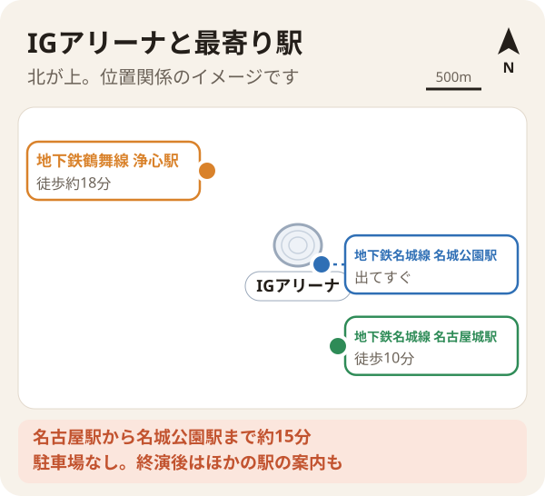
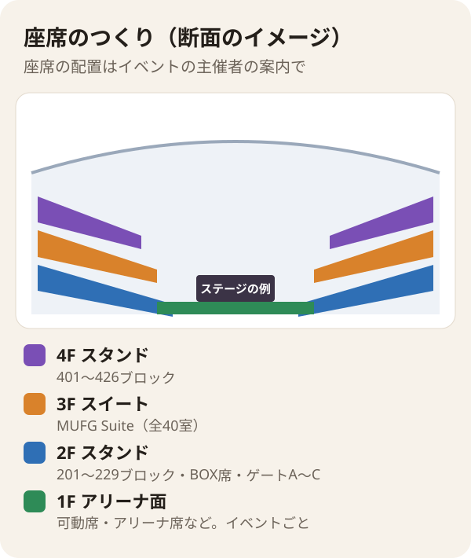
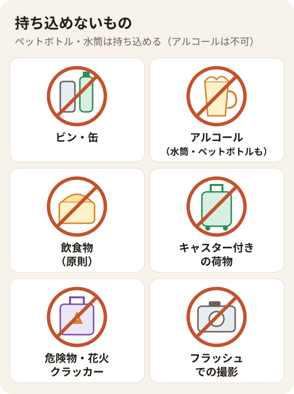

{% assign _today = site.time | date: "%Y-%m-%d" %}
この公演は終わりました。&TEAMのこれからの公演は<a href="https://www.hybejapan-concert.com/statics/andteam_mark_on_you" target="_blank" rel="noopener">公式サイト</a>で確かめてください。


<section class="after-show" id="after">
<h2>🎵 公演のあと（セトリ・次の公演）</h2>

セットリストは、大手報道のライブレポートに載ったら、出典つき・ネタバレ注意の閉じた形でここに載せます。

ほかの会場の日程・セトリは：<a href="{{ p.url }}">エンティーム ツアー'Mark on You' アリーナ公演2027（神戸・名古屋・横浜・香川・福岡・宮城）まとめ</a>


</section>

<strong>&TEAM</strong>『2026-2027 &amp;TEAM CONCERT TOUR 'Mark on You'』の<strong>IGアリーナ</strong>公演は、<strong>2027年2月6日（土）・7日（日）</strong>です（<a href="https://www.hybejapan-concert.com/statics/andteam_mark_on_you" target="_blank" rel="noopener">公式の公演情報</a>・2026年11月26日時点）。この記事では、IGアリーナへの行き方・座席のつくり・持ち込めないもの・当日の準備と、会場の近くに泊まる宿の探し方、&TEAMのメンバーが番組やYouTubeで訪れたお店をまとめました。

<b>公演日</b>2027年2月6日（土）・7日（日）

<nav class="live-jump" aria-label="この記事の章"><a class="chip chip--area" href="#date">日程</a><a class="chip chip--area" href="#tickets">チケット</a><a class="chip chip--area" href="#access">行き方</a><a class="chip chip--area" href="#seats">座席</a><a class="chip chip--area" href="#rules">持ち込み</a><a class="chip chip--area" href="#stay">泊まる</a><a class="chip chip--area" href="#seichi">近くの聖地</a></nav>

  
🛏 IGアリーナ周辺に泊まる<small class="stay-in__pr">PR</small><a class="stay-in__more" href="#stay">宿の選び方 ↓</a>

  

    {% include affiliate-link.html url="https://www.jalan.net/uw/uwp2011/uww2011init.do?keyword=IG%83A%83%8A%81%5B%83i" label="じゃらんで探す" class="btn btn--accent" service="jalan" %}
    {% include affiliate-link.html url="https://kw.travel.rakuten.co.jp/keyword/Search.do?charset=utf-8&f_query=IG%E3%82%A2%E3%83%AA%E3%83%BC%E3%83%8A" label="楽天トラベルで探す" class="btn" service="rakuten" %}
  



はじめて&TEAMのライブに行くなら：<a href="/guide/kpop-andteam-first-live/">エンティームのライブ初参戦ガイド（ペンライトの色・コール・定番曲・入場）</a>

ほかの会場の日程・時刻・セトリは：<a href="{{ p.url }}">エンティーム ツアー'Mark on You' アリーナ公演2027（神戸・名古屋・横浜・香川・福岡・宮城）まとめ</a>

<h2 id="date">公演の日程</h2>

<ul class="live-dates">
  <li><b>2027年2月6日（土）</b>開場17:00／開演18:00</li>
  <li><b>2027年2月7日（日）</b>開場15:00／開演16:00</li>
</ul>

会場：<strong>IGアリーナ</strong>（愛知県）。公演名：2026-2027 &amp;TEAM CONCERT TOUR 'Mark on You'。

日程・時刻は2026年11月26日時点の<a href="https://www.hybejapan-concert.com/statics/andteam_mark_on_you" target="_blank" rel="noopener">公式発表</a>です。変わることがあるので、行く前に公式サイトで確かめてください。チケットの値段はこの記事では扱いません（受付の日程は「チケットの受付」に）。

<h2 id="tickets">チケットの受付</h2>

IGアリーナ公演のチケットの受付です（2026年11月26日時点の公式発表）。

<ol class="tk-list">
  <li class="tk is-tba" data-s="" data-e="">未発表<b class="tk__n">プレミアムシート アップグレード抽選</b>「詳細は後日」（2026年11月25日時点）<a class="tk__go" href="https://www.andteam-official.jp/news/a19339147e37" target="_blank" rel="noopener">公式のお知らせ</a></li>
  <li class="tk is-tba" data-s="" data-e="">未発表<b class="tk__n">一般発売（アリーナ公演）</b>未発表（2026年11月25日時点）<a class="tk__go" href="https://www.hybejapan-concert.com/statics/andteam_mark_on_you" target="_blank" rel="noopener">公式のお知らせ</a></li>
</ol>

終わった受付（1）

<ol class="tk-list">
  <li class="tk is-done" data-s="2026-11-07T13:00" data-e="2026-11-15T23:59">終了<b class="tk__n">LUNÉ MEMBERSHIP 会員先行（抽選・アリーナ公演）</b>11月7日（土）13:00〜11月15日（日）23:59ファンクラブ LUNÉ MEMBERSHIP（日本）の会員（同行者は会員でなくてよい）・指定席。当落と入金は11月24日11:00〜11月29日23:00（ローソン・ミニストップで支払い）<a class="tk__go" href="https://www.andteam-official.jp/news/a19339147e37" target="_blank" rel="noopener">公式のお知らせ</a></li>
</ol>

チケットはローソン・ミニストップで発券する紙のチケットです。3歳以上はチケットが必要で、3歳未満は入れません。プレミアムシートの一般販売はありません。 値段や席ごとの条件は公式のお知らせで確かめてください。チケットは公式の受付（公式のリセールがあればそれ）で買い、転売サイトでは買わないようにしましょう。

<h2 id="access">会場への行き方</h2>

<ul>
  <li><strong>地下鉄名城線 名城公園駅</strong>：出てすぐ</li>
  <li><strong>地下鉄名城線 名古屋城駅</strong>：徒歩10分</li>
  <li><strong>地下鉄鶴舞線 浄心駅</strong>：徒歩約18分</li>
</ul>

<figure class="fig"><figcaption>IGアリーナ公式サイトのアクセス案内をもとに作図</figcaption></figure>

名古屋駅から名城公園駅まで約15分

駐車場なし。終演後はほかの駅の案内も

<h2 id="seats">座席のつくり</h2>

<figure class="fig"><figcaption>会場の公式情報をもとに作図。ステージの位置や客席の並びは公演ごとに変わります</figcaption></figure>

<ul>
  <li><strong>4F スタンド</strong>：401〜426ブロック</li>
  <li><strong>3F スイート</strong>：MUFG Suite（全40室）</li>
  <li><strong>2F スタンド</strong>：201〜229ブロック・BOX席・ゲートA〜C</li>
  <li><strong>1F アリーナ面</strong>：可動席・アリーナ席など。イベントごと</li>
</ul>

座席の配置はイベントの主催者の案内で。&TEAMの公演の席は、チケットに書かれたゲート・席番号で確かめてください。

<h2 id="rules">持ち込めないもの・当日の準備</h2>

<figure class="fig"><figcaption>会場の公式サイトの案内より</figcaption></figure>

会場のルールで持ち込めないもの：ビン・缶、アルコール（水筒・ペットボトルも）、飲食物（原則）、キャスター付きの荷物、危険物・花火クラッカー、フラッシュでの撮影。グッズの扱い・撮影・うちわやペンライトの決まりは公演ごとに違うので、&TEAMの公式の注意事項で確かめてください。

<ul>
  <li><strong>完全キャッシュレス</strong>：現金は使えない。カード・電子マネー・QR</li>
  <li><strong>ロッカーは交通系ICで</strong>：場外3か所・場内3か所。イベントの日だけ使える</li>
  <li><strong>荷物は足元に入る大きさ</strong>：キャリーケースなど。キャスター付きはNG</li>
  <li><strong>駐車場はない</strong>：タクシー乗降所も常設なし。公共交通機関で</li>
</ul>

IGアリーナ公式サイト（よくあるご質問）より

<a class="btn" href="/guide/ig-arena/">IGアリーナのライブ参戦ガイドをくわしく</a>

<h2 id="seichi">会場の近くの&TEAMの聖地</h2>

2026年11月時点で、愛知県に&TEAMのメンバーが行ったお店は登録されていません。

会場の近くにある、ほかの推しの聖地も。



<a class="btn" href="/shops/?near=35.189587,136.902652&amp;nl=IG%E3%82%A2%E3%83%AA%E3%83%BC%E3%83%8A">地図で会場の近くのお店</a><a class="btn" href="/shops/?g=kpop_andteam&amp;view=map">地図で&TEAMのお店を見る</a>

<h2 id="stay">泊まる</h2>

終演後は最寄り駅が混み合います。夜の公演のあとに遠くまで移動しなくていいように、会場の近くや乗り換えの少ない駅の近くの宿を早めに探しておくと安心です。

  
🛏 IGアリーナ周辺に泊まる<small class="stay-in__pr">PR</small>

  

    {% include affiliate-link.html url="https://www.jalan.net/uw/uwp2011/uww2011init.do?keyword=IG%83A%83%8A%81%5B%83i" label="じゃらんで探す" class="btn btn--accent" service="jalan" %}
    {% include affiliate-link.html url="https://kw.travel.rakuten.co.jp/keyword/Search.do?charset=utf-8&f_query=IG%E3%82%A2%E3%83%AA%E3%83%BC%E3%83%8A" label="楽天トラベルで探す" class="btn" service="rakuten" %}
  



<ul>
  <li><a href="/guide/live-ensei-checklist/">ライブ遠征の準備チェックリスト</a>：持ち物・宿・当日の動き方</li>
  <li><a href="/guide/live-ensei-transport/">ライブ遠征の交通手段ガイド</a>：新幹線・飛行機・高速バスの使い分け</li>
  <li><a href="/ensei/">ライブ遠征×聖地巡礼</a>：全国の会場の近くの聖地と宿</li>
</ul>

<h2 id="more">あわせて読みたい</h2>

<ul>
  <li><a href="/guide/ig-arena/">IGアリーナ ライブ参戦ガイド</a>（基本情報・ゲート・お金と荷物）</li>
  <li><a href="/guide/kpop-andteam-first-live/">エンティームのライブ初参戦ガイド</a>（ペンライトの色・コール・定番曲・入場・グッズ）</li>
  <li><a href="{{ p.url }}">エンティーム ツアー'Mark on You' アリーナ公演2027（神戸・名古屋・横浜・香川・福岡・宮城）まとめ</a>（全会場の日程・時刻・セトリ）</li>
  <li><a href="{{ site.data.group_ix.kpop_andteam.u }}">&TEAMのお店一覧</a>（グループのページ）</li>
</ul>

お店の情報は、各お店の出典（番組・YouTube・ファンのロケ地ブログ）をもとにしています。会場からの距離は直線距離で、歩く距離とは違います。会場の情報はIGアリーナの公式サイトにもとづきます。

