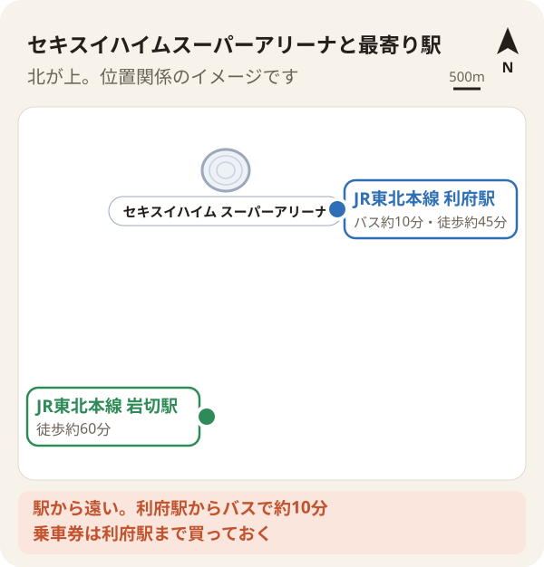
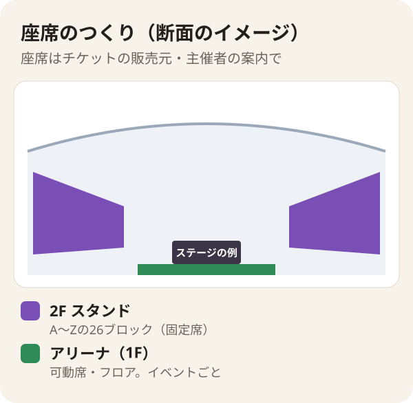

{% assign _today = site.time | date: "%Y-%m-%d" %}
この公演は終わりました。Travis Japanのこれからの公演は<a href="https://www.mspf.jp/grande21/index.php?action=event_show_detail&amp;event_id=1053&amp;target=event" target="_blank" rel="noopener">公式サイト</a>で確かめてください。


<section class="after-show" id="after">
<h2>🎵 公演のあと（セトリ・次の公演）</h2>

セットリストは、大手報道のライブレポートに載ったら、出典つき・ネタバレ注意の閉じた形でここに載せます。


</section>

<strong>Travis Japan</strong>『Travis Japan Concert Tour 2027 Jewelry Basket』の<strong>セキスイハイムスーパーアリーナ</strong>公演は、<strong>2027年1月16日（土）・17日（日）</strong>です（<a href="https://www.mspf.jp/grande21/index.php?action=event_show_detail&amp;event_id=1053&amp;target=event" target="_blank" rel="noopener">公式の公演情報</a>・2026年11月27日時点）。この記事では、セキスイハイムスーパーアリーナへの行き方・座席のつくり・持ち込めないもの・当日の準備と、会場の近くに泊まる宿の探し方、Travis Japanのメンバーが番組やYouTubeで訪れたお店をまとめました。

<b>公演日</b>2027年1月16日（土）・17日（日）

<nav class="live-jump" aria-label="この記事の章"><a class="chip chip--area" href="#date">日程</a><a class="chip chip--area" href="#access">行き方</a><a class="chip chip--area" href="#seats">座席</a><a class="chip chip--area" href="#rules">持ち込み</a><a class="chip chip--area" href="#stay">泊まる</a><a class="chip chip--area" href="#seichi">近くの聖地</a></nav>

  
🛏 セキスイハイムスーパーアリーナ周辺に泊まる<small class="stay-in__pr">PR</small><a class="stay-in__more" href="#stay">宿の選び方 ↓</a>

  

    {% include affiliate-link.html url="https://www.jalan.net/uw/uwp2011/uww2011init.do?keyword=%83Z%83L%83X%83C%83n%83C%83%80%83X%81%5B%83p%81%5B%83A%83%8A%81%5B%83i" label="じゃらんで探す" class="btn btn--accent" service="jalan" %}
    {% include affiliate-link.html url="https://kw.travel.rakuten.co.jp/keyword/Search.do?charset=utf-8&f_query=%E3%82%BB%E3%82%AD%E3%82%B9%E3%82%A4%E3%83%8F%E3%82%A4%E3%83%A0%E3%82%B9%E3%83%BC%E3%83%91%E3%83%BC%E3%82%A2%E3%83%AA%E3%83%BC%E3%83%8A" label="楽天トラベルで探す" class="btn" service="rakuten" %}
  



<h2 id="date">公演の日程</h2>

<ul class="live-dates">
  <li><b>2027年1月16日（土）</b>1回目 開演13:00、2回目 開演18:00</li>
  <li><b>2027年1月17日（日）</b>開演14:00</li>
</ul>

会場：<strong>セキスイハイムスーパーアリーナ</strong>（宮城県）。公演名：Travis Japan Concert Tour 2027 Jewelry Basket。

日程と開演の時刻は、会場（セキスイハイムスーパーアリーナ）の公式サイトより。開場の時刻とチケットの受付は確かめられませんでした（2026年11月27日時点）。STARTO ENTERTAINMENTの公式の案内で確かめてください。

日程・時刻は2026年11月27日時点の<a href="https://www.mspf.jp/grande21/index.php?action=event_show_detail&amp;event_id=1053&amp;target=event" target="_blank" rel="noopener">公式発表</a>です。変わることがあるので、行く前に公式サイトで確かめてください。チケットの申し込みや値段はこの記事では扱いません。

<h2 id="access">会場への行き方</h2>

<ul>
  <li><strong>JR東北本線 利府駅</strong>：バス約10分・徒歩約45分</li>
  <li><strong>JR東北本線 岩切駅</strong>：徒歩約60分</li>
</ul>

<figure class="fig"><figcaption>セキスイハイムスーパーアリーナ公式サイトのアクセス案内をもとに作図</figcaption></figure>

駅から遠い。利府駅からバスで約10分

乗車券は利府駅まで買っておく

<h2 id="seats">座席のつくり</h2>

<figure class="fig"><figcaption>会場の公式情報をもとに作図。ステージの位置や客席の並びは公演ごとに変わります</figcaption></figure>

<ul>
  <li><strong>2F スタンド</strong>：A〜Zの26ブロック（固定席）</li>
  <li><strong>アリーナ（1F）</strong>：可動席・フロア。イベントごと</li>
</ul>

座席はチケットの販売元・主催者の案内で。Travis Japanの公演の席は、チケットに書かれたゲート・席番号で確かめてください。

<h2 id="rules">持ち込めないもの・当日の準備</h2>

<ul>
  <li><strong>コインロッカーは使えない</strong>：コンサートの日は。施設内のロッカーが使えない</li>
  <li><strong>売店・ATMはない</strong>：コンビニは車で5分ほど。必要な物は先に買っておく</li>
  <li><strong>JRの切符は利府駅まで</strong>：「仙台市内」の切符だと。利府駅で乗り越し精算に</li>
  <li><strong>駐車場は主催者が販売</strong>：コンサートの日は有料。送迎は第1駐車場で</li>
</ul>

セキスイハイムスーパーアリーナ公式サイト（コンサート来場時の留意事項・Q&amp;A）より

<a class="btn" href="/guide/sekisui-heim-super-arena/">セキスイハイムスーパーアリーナのライブ参戦ガイドをくわしく</a>

<h2 id="seichi">会場の近くのTravis Japanの聖地</h2>

2026年11月時点で、宮城県にTravis Japanのメンバーが行ったお店は登録されていません。

会場の近くにある、ほかの推しの聖地も。



<a class="btn" href="/shops/?near=38.337561,140.953119&amp;nl=%E3%82%BB%E3%82%AD%E3%82%B9%E3%82%A4%E3%83%8F%E3%82%A4%E3%83%A0%E3%82%B9%E3%83%BC%E3%83%91%E3%83%BC%E3%82%A2%E3%83%AA%E3%83%BC%E3%83%8A">地図で会場の近くのお店</a><a class="btn" href="/shops/?g=travisjapan&amp;view=map">地図でTravis Japanのお店を見る</a>

<h2 id="stay">泊まる</h2>

終演後は最寄り駅が混み合います。夜の公演のあとに遠くまで移動しなくていいように、会場の近くや乗り換えの少ない駅の近くの宿を早めに探しておくと安心です。

  
🛏 セキスイハイムスーパーアリーナ周辺に泊まる<small class="stay-in__pr">PR</small>

  

    {% include affiliate-link.html url="https://www.jalan.net/uw/uwp2011/uww2011init.do?keyword=%83Z%83L%83X%83C%83n%83C%83%80%83X%81%5B%83p%81%5B%83A%83%8A%81%5B%83i" label="じゃらんで探す" class="btn btn--accent" service="jalan" %}
    {% include affiliate-link.html url="https://kw.travel.rakuten.co.jp/keyword/Search.do?charset=utf-8&f_query=%E3%82%BB%E3%82%AD%E3%82%B9%E3%82%A4%E3%83%8F%E3%82%A4%E3%83%A0%E3%82%B9%E3%83%BC%E3%83%91%E3%83%BC%E3%82%A2%E3%83%AA%E3%83%BC%E3%83%8A" label="楽天トラベルで探す" class="btn" service="rakuten" %}
  



<ul>
  <li><a href="/guide/live-ensei-checklist/">ライブ遠征の準備チェックリスト</a>：持ち物・宿・当日の動き方</li>
  <li><a href="/guide/live-ensei-transport/">ライブ遠征の交通手段ガイド</a>：新幹線・飛行機・高速バスの使い分け</li>
  <li><a href="/ensei/">ライブ遠征×聖地巡礼</a>：全国の会場の近くの聖地と宿</li>
</ul>

<h2 id="more">あわせて読みたい</h2>

<ul>
  <li><a href="/guide/sekisui-heim-super-arena/">セキスイハイムスーパーアリーナ ライブ参戦ガイド</a>（基本情報・ゲート・お金と荷物）</li>
  <li><a href="{{ site.data.group_ix.travisjapan.u }}">Travis Japanのお店一覧</a>（グループのページ）</li>
</ul>

お店の情報は、各お店の出典（番組・YouTube・ファンのロケ地ブログ）をもとにしています。会場からの距離は直線距離で、歩く距離とは違います。会場の情報はセキスイハイムスーパーアリーナの公式サイトにもとづきます。

